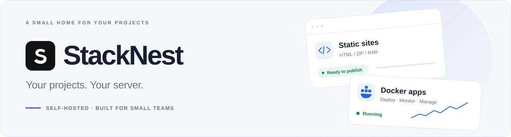

  <picture>
    <source media="(prefers-color-scheme: dark)" srcset="docs/images/stacknest-banner-dark.svg">
    
  </picture>

  
<strong>静态站点与 Docker 应用，一个轻量的部署控制台。</strong>

  
为个人开发者和小团队准备，在自己的服务器上部署、预览和管理项目。

  

    <a href="docs/INSTALL_RELEASE.md"><strong>开始部署 →</strong></a> ·
    <a href="https://github.com/zby909/stack-nest-server/releases">下载版本</a> ·
    <a href="docs/README.md">文档</a> ·
    <a href="https://github.com/zby909/stack-nest-web">Web 仓库</a>
  

  

    
    
    
    
  

## 一个地方，管理两种项目

| 📄 静态站点 | 🐳 Docker 应用 | 🛠️ 日常管理 |
| --- | --- | --- |
| 上传单个 HTML、ZIP 或 RAR 断点续传，独立预览与确认发布 保留当前版与上一版，可随时回退 | 填写已有镜像地址，部署 HTTP 服务 配置环境变量与持久化数据目录 查看日志、资源用量，执行启停和重启 | 邮箱验证码登录与成员权限 操作日志、服务器状态与诊断 备份、恢复，以及整套实例迁移 |

支持手机布局和明暗主题。CPU、内存与上传容量均有限制；磁盘硬配额及局域网保护按部署环境启用。

> 成员权限保护后台操作；静态站点、Docker 应用和独立预览地址默认公开。

## 看看界面

**上传 → 预览 → 发布。** 静态项目集中管理，版本与空间占用一目了然。

**让应用运行起来。** Docker 应用的健康状态、资源用量和管理操作放在同一张卡片中。

  
<strong>📱 手机布局 · 🌙 深色主题与平台诊断</strong>

   
  

  

以上为实际界面截图，使用虚构的演示数据。

## 在自己的服务器上运行

推荐使用 [Docker 版本部署包](docs/INSTALL_RELEASE.md)，服务器无需安装 Go 或 Node.js。安装以所下载版本的包内 README 为准。

1. **下载**：从 [Releases](https://github.com/zby909/stack-nest-server/releases) 获取部署包与校验文件。
2. **配置**：准备域名、SMTP 邮箱和 HTTPS 证书，按安装教程填写配置。
3. **启动**：运行 `docker compose pull` 和 `docker compose up -d --wait --wait-timeout 120`。

支持 **Linux amd64**，需要 Docker Engine **26+**、Compose **2.24.4+**、至少 **2 GiB 内存**；可选应用联网保护需要 Engine **28+**。安装完成后，可上传 [最小示例站点](examples/README.md)体验完整发布流程。

🏠 没有公网 IP？另有 [家用电脑 + Cloudflare Tunnel 教程](docs/HOME_SERVER_TUNNEL.md)。

## 按需阅读

| 想做什么 | 从这里开始 |
| --- | --- |
| 使用平台、部署 Docker 应用 | [使用指南](docs/USAGE.md) · [Docker 应用](docs/DOCKER_APPS.md) |
| 用 AI 或 GitHub Actions 更新静态站点 | [项目 Token 与自动部署](docs/AUTOMATION.md) |
| 备份、升级或换服务器 | [日常运维](docs/OPERATIONS.md) · [迁移](docs/MIGRATION.md) |
| 了解组件怎样协作 | [架构与工作原理](docs/ARCHITECTURE.md) |
| 修改代码或参与开发 | [开发与测试](docs/DEVELOPMENT.md) · [Web 仓库](https://github.com/zby909/stack-nest-web) |
| 从源码部署或发布版本 | [源码部署](docs/GETTING_STARTED.md) · [版本发布](docs/RELEASING.md) |

后端使用 **Go · PostgreSQL · Ent · Atlas**；管理界面使用 **React · TypeScript · Vite · Tailwind CSS**。

## 参与与许可

欢迎通过 [Issue](https://github.com/zby909/stack-nest-server/issues)反馈问题和使用场景。提交改动前请阅读 [贡献指南](CONTRIBUTING.md)。

Copyright 2026 zby909 and StackNest contributors. 使用 [Apache-2.0](LICENSE) 许可，第三方内容保留原许可，见 [NOTICE](NOTICE)。
