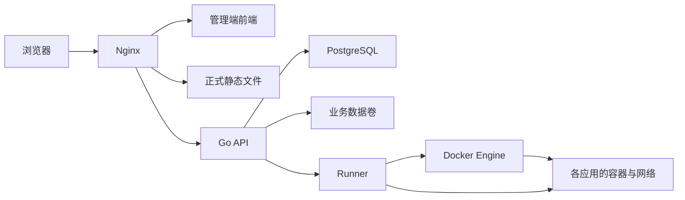

# 架构与工作原理

StackNest 面向可信成员使用的单服务器实例。这里解释服务如何协作，安装步骤见 [Docker 部署](INSTALL_RELEASE.md)。

## 服务分工

| 服务       | 职责                                             |
| ---------- | ------------------------------------------------ |
| Nginx      | 提供管理端前端、读取正式静态文件、按域名分发请求 |
| Go API     | 邮箱认证、权限、上传、版本和应用任务             |
| Runner     | 管理 Docker 容器、代理应用请求、采样资源         |
| PostgreSQL | 用户、会话、项目、版本、任务和配置               |
| migrate    | 启动时执行数据库迁移，成功后退出                 |

前端是 Nginx 中的构建文件，不需要 Node 服务。API 和 Runner 使用同一 Go 镜像的不同子命令。

## 访问入口

普通服务器由 Nginx 直接处理 HTTPS。Cloudflare 普通代理仍通过 HTTPS 连接服务器。

Tunnel 则由宿主 cloudflared 主动建立加密连接，再通过本机 HTTP 交给 Nginx；服务器不需要公网入站端口。

四个平台服务在容器中运行；可选 cloudflared、联网保护及备份定时器在宿主运行。

## 请求如何找到项目

Nginx 按 Host 分流。正式站点直接读取文件；预览和应用由 Go 查询数据库，确认记录仍有效。

- 管理域名：前端页面和管理 API。
- `stack-nest-{slug}`：Nginx 直接读取已发布静态文件。
- `stack-nest--{版本UUID}`：Go 检查版本仍保留后提供预览。
- `stack-nest--app-{slug}`：Nginx → Go → Runner → 应用私有端口。
- 未配置的域名或不存在的项目：404。

后台和项目使用不同来源。上传站点自己的 `/api` 不会成为平台管理 API。

## 归属与会话

项目所有者保存在 PostgreSQL，创建时由服务端登录用户决定。目录、slug 和 UUID 用于定位资源，不能替代权限校验。

普通用户管理自己的项目；管理员管理全部；超管另管理角色、网络和实例预算。前端隐藏入口只改善体验，服务端仍校验每项操作。

HTTPS 会话使用 Secure、HttpOnly、SameSite 和主机限定 Cookie。应用代理过滤管理 Cookie，限制应用 Cookie 的父域作用域。

站点和预览内容默认公开，持有预览链接即可访问；版本清理或暂停后预览失效。

## 上传与版本切换

浏览器将归档分为 4 MiB 分片，服务端持久保存偏移。中断后查询偏移继续，完成时校验整个文件 SHA256 再解压。

每个项目保留当前版、上一版和一个草稿。发布通过同一数据卷内的目录移动切换；数据库与文件间保留恢复标记，启动时完成或撤销中断事务。该过程不承诺零停机。

`pending`、`changes`、`trash` 是内部恢复目录，不能作为普通临时文件清理。`trash` 不是用户回收站。

## Docker 应用隔离

平台的四个服务在 Compose 网络中，每个用户应用另有独立 bridge。Runner 接入应用网络代理请求，应用不接入平台网络，也不发布宿主端口。

只有 Runner 挂载 Docker socket；API 通过私有 Unix socket 请求固定操作。Runner 只管理带本实例标签的资源，不接受任意宿主目录或命令。

应用沿用镜像 USER，可以是容器内 root；禁止 privileged、host 网络、Docker socket 和任意宿主挂载，并设置 CPU、内存、PID 与日志限制。

容器共享宿主内核，当前信任边界是个人和团队成员。Runner 持有 Docker 高权限，属于受信任组件。

### 联网保护

默认应用网络为 internal，不能主动访问公网。可选 Go 宿主服务维护自己的 nftables 表，只约束平台应用网桥。

规则允许公网和 Linux 本机服务，阻止配置的其他局域网目标；在 DNAT 前识别本机地址，因此宿主发布端口仍可访问。应用对访客连接的回复允许通过。

网卡地址与补充 CIDR 共同确定禁止范围。NAT 虚拟机只能识别自身网段，外部家庭网络需要补充配置。应用 DNS 使用指定公共解析器。

服务周期核对规则，状态缺失或过期时 Runner 拒绝新的联网操作。配置入口只对超管开放。[配置步骤](NETWORK_EGRESS.md)

### 磁盘配额

CPU 与内存由 cgroups 限制，磁盘容量由 XFS Project Quota 限制。

传统 overlay2 的 size 约束容器可写层；Runner 为每应用持久化目录设置容量和 inode 配额。命名卷不会自动受可写层上限约束。

配额需要 XFS、ftype=1、prjquota 和匹配的 Docker 存储布局。root 应用也不能通过被 seccomp 禁止的配额属性修改撤销限额。[启用步骤](STORAGE_QUOTAS.md)

## 数据、备份与升级

| 存储             | 内容                                       |
| ---------------- | ------------------------------------------ |
| `postgres-data`  | 用户、会话、项目、版本、任务、配置密文     |
| `stacknest-data` | 站点、草稿、恢复标记、上传、日志、应用数据 |
| `runner-control` | 内部 Unix socket                           |
| `backup-status`  | 备份摘要，非完整备份                       |

`STACKNEST_AUTH_SECRET` 还派生 Docker 配置加密密钥，升级和迁移保留原值。

备份停止 API 和正在运行的应用，保存同一时点的数据库及文件，再恢复原状态。迁移包额外保存镜像与运行配置；未完成上传不打包。

应用更新失败只尝试恢复容器，不撤销应用自己的数据库或文件修改。[备份与升级](OPERATIONS.md) · [迁移](MIGRATION.md)

## 缓存

正式静态站点使用 `no-cache`：浏览器可保存，但每次使用前验证。Nginx 的 ETag 与 Last-Modified 命中时返回 304。

API、版本预览、Docker 应用和错误响应使用 `no-store`。Cloudflare 应尊重源站标头，避免同名 CSS 等文件仍使用旧缓存。

## 版本发布

GitHub Actions 按两仓库同名标签固定提交，检查、构建并实际启动三个镜像。成功后推送 GHCR、记录镜像摘要并生成部署包。

部署包只包含公开清单中的配置与工具，不带实例密码或业务数据。三个 IMAGE 固定摘要，用户显式升级，不自动跟随 latest。[发布步骤](RELEASING.md)

## 源码分工

| 目录                                             | 内容                        |
| ------------------------------------------------ | --------------------------- |
| `internal/httpserver`                            | 路由、认证边界与契约转换    |
| `internal/auth`、`internal/postgres`             | 邮箱、角色、数据事务        |
| `internal/project`、`internal/staticdeploy`      | 静态项目与文件发布          |
| `internal/resumable`、`internal/storage`         | 续传与空间保护              |
| `internal/containerapp`、`internal/dockerrunner` | 应用任务、Docker 操作与代理 |
| `internal/egress`                                | 宿主网络保护                |
| `openapi`、`migrations`                          | 接口契约、数据库迁移        |
| `deploy`                                         | 入口、备份、迁移和部署工具  |

[开发与测试](DEVELOPMENT.md)
