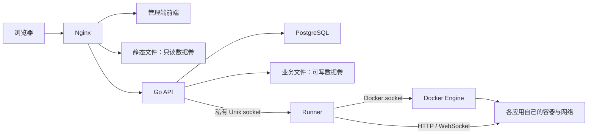

# 架构与维护边界

StackNest 面向可信成员使用的单服务器实例。当前支持静态站点和单个 Docker HTTP 服务，不提供公共多租户 PaaS、Kubernetes 编排或用户源码构建。

## 四个常驻容器

| 服务        | 职责                               | 对宿主暴露                   |
| ----------- | ---------------------------------- | ---------------------------- |
| `nginx`     | 前端、正式静态文件、域名分流       | 选定的 HTTPS 或本机回环入口  |
| `stacknest` | 认证、权限、上传、预览、应用任务   | 不发布 8080                  |
| `runner`    | Docker 生命周期、代理与计量        | 私有 Unix socket，不监听 TCP |
| `postgres`  | 用户、会话、项目、版本、任务和预算 | 不发布 5432                  |
| `migrate`   | 执行数据库迁移后退出               | 无                           |

前端打包进 Nginx，不再运行 Node 服务。API 与 Runner 使用同一个 Go 镜像的不同子命令。可选 cloudflared、网络保护和备份定时器在宿主运行，不计入四个常驻容器。

静态正式站点由 Nginx 读取，版本预览由 Go 按数据库保留状态打开文件。应用请求经过 Nginx、Go、Runner 到私有地址；应用自己的 `/api/` 不会落到后台接口。

## 网络与权限

四个常驻服务位于平台 Compose 网络。每应用另有独立 bridge；Runner 接入它代理请求，应用不接入平台网络。默认 internal 网络不主动访问公网；开启 [受控联网](NETWORK_EGRESS.md)后允许公网与 Linux 本机服务，拦截配置的其他局域网地址。

| 能力                 | 普通用户     | 管理员       | 超管         |
| -------------------- | ------------ | ------------ | ------------ |
| 项目及 Docker 应用   | 自己的       | 全部         | 全部         |
| 操作日志             | 自己可见范围 | 全部保留记录 | 全部保留记录 |
| 增删普通邮箱         | 无           | 有           | 有           |
| 添加管理员、调整角色 | 无           | 无           | 有           |
| 服务器状态、备份摘要 | 无           | 有           | 有           |
| 网络和实例资源预算   | 无           | 无           | 有           |

后端执行权限校验，前端隐藏按钮只改善体验。所属用户是数据库外键，目录和 URL 不是授权凭据。删除普通用户按事务转交资源；管理员也不能接管别人的续传任务。

HTTPS 会话使用主机限定 Cookie，写接口校验来源。站点和管理页分属不同来源；版本预览不是私有分享。应用代理过滤管理 Cookie，并去掉应用 Cookie 的父域作用域。

## 文件和密钥

| 存储             | 内容                                               |
| ---------------- | -------------------------------------------------- |
| `postgres-data`  | 用户、会话、项目、版本、配置密文、任务             |
| `stacknest-data` | 静态文件、草稿、事务标记、临时上传、日志、应用数据 |
| `runner-control` | 内部 socket，用户应用不能挂载                      |
| `backup-status`  | 只读摘要，不是完整备份                             |

`STACKNEST_AUTH_SECRET` 同时用于验证码摘要和派生 Docker 配置加密密钥。**有应用后不要直接改值**，否则旧环境变量和仓库密码无法解密。迁移保留原密钥，当前没有在线重加密轮换工具。

应用沿用镜像 USER，可以是容器内 root。不使用 privileged 或 host 网络，不挂 Docker socket，只挂自己的可选数据目录。CPU、内存、PID、日志和镜像大小有界；磁盘硬限额另需 [XFS 配额](STORAGE_QUOTAS.md)。Docker 不等同虚拟机，Runner 持有宿主 Docker 的高权限，属于受信任组件。

日志遮盖平台知道的候选与生效配置值，不能识别应用自行产生的全部敏感内容。更新失败恢复旧容器，不撤销数据库结构或持久化目录的业务修改。

## 源码分工

| 目录                                         | 内容                                  |
| -------------------------------------------- | ------------------------------------- |
| `internal/httpserver`                        | 路由、请求边界和契约转换              |
| `internal/auth` / `internal/postgres`        | 邮箱、角色和数据事务                  |
| `internal/project` / `internal/staticdeploy` | 项目规则、解压、文件发布和恢复        |
| `internal/resumable` / `internal/storage`    | 续传、摘要和空间预留                  |
| `internal/containerapp`                      | 归属、加密、队列、日志遮盖            |
| `internal/dockerrunner`                      | Docker 固定参数、私有代理、配额与采样 |
| `internal/egress`                            | 可选宿主网络规则和控制接口            |
| `openapi` / `migrations`                     | 接口契约与不可改写的数据库迁移        |
| `deploy`                                     | 入口、备份、迁移与部署回归            |

改角色、续传或应用约束时核对前后端契约。数据库升级新增迁移，不修改已应用 SQL。开发和测试见 README，部署从 [文档导航](README.md)开始。
